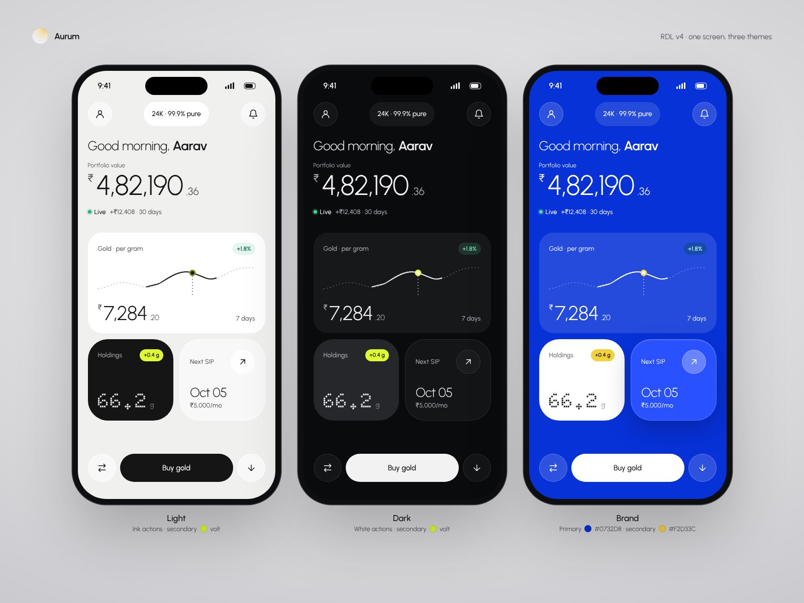
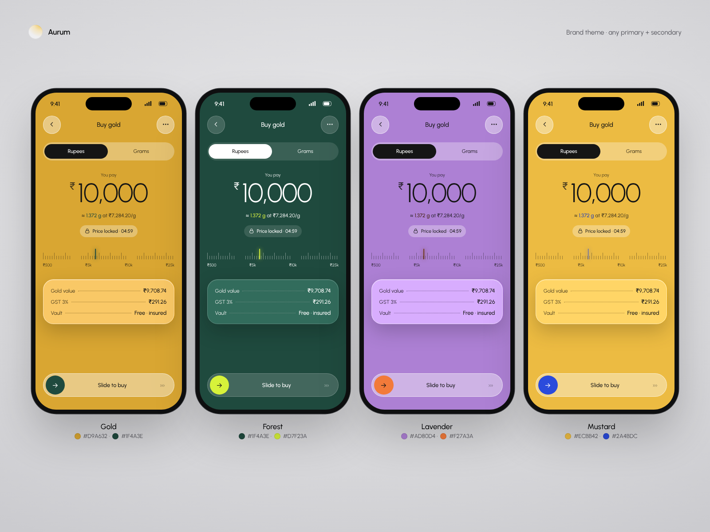
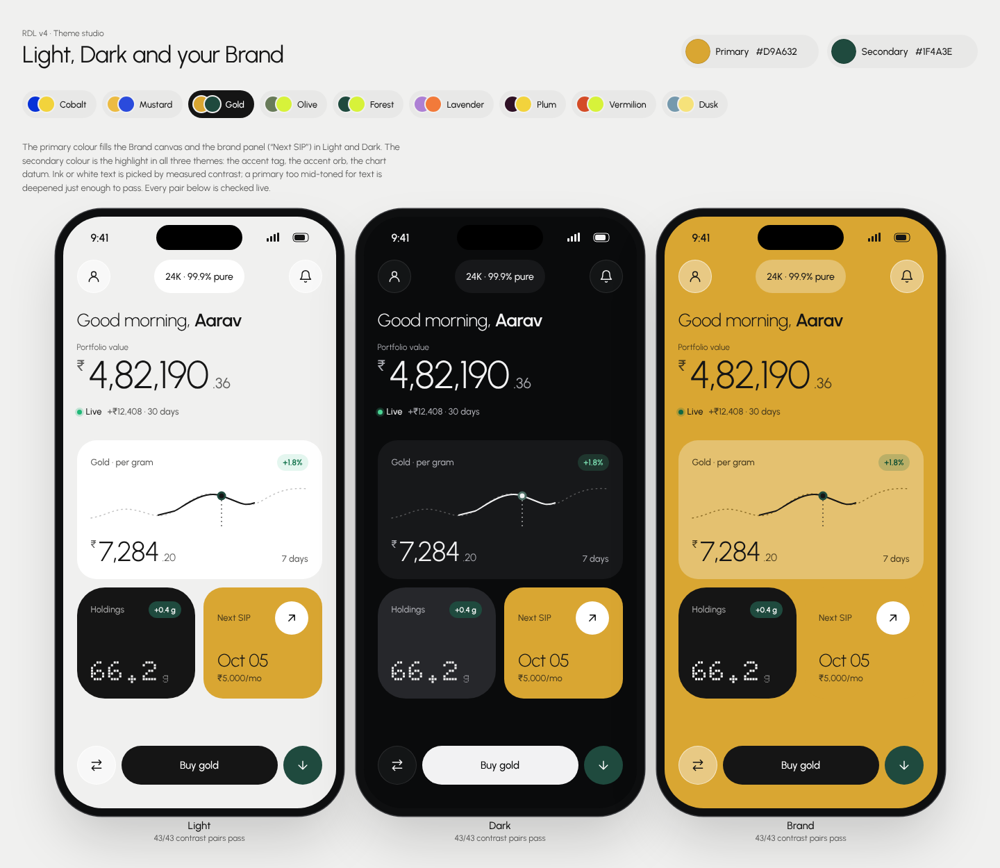
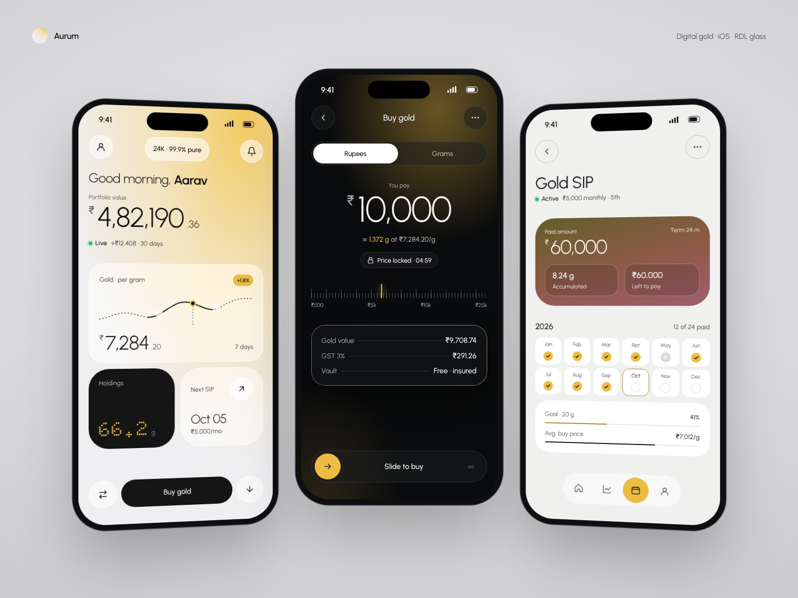
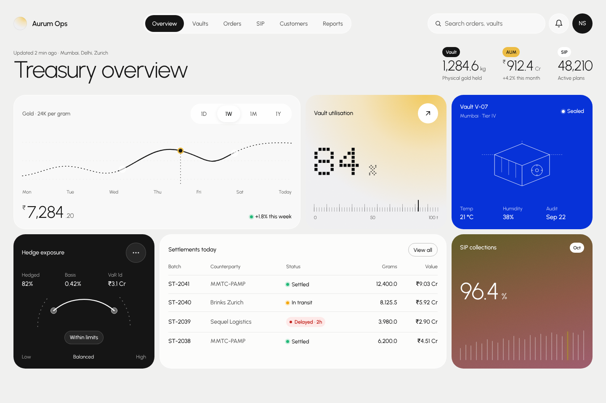
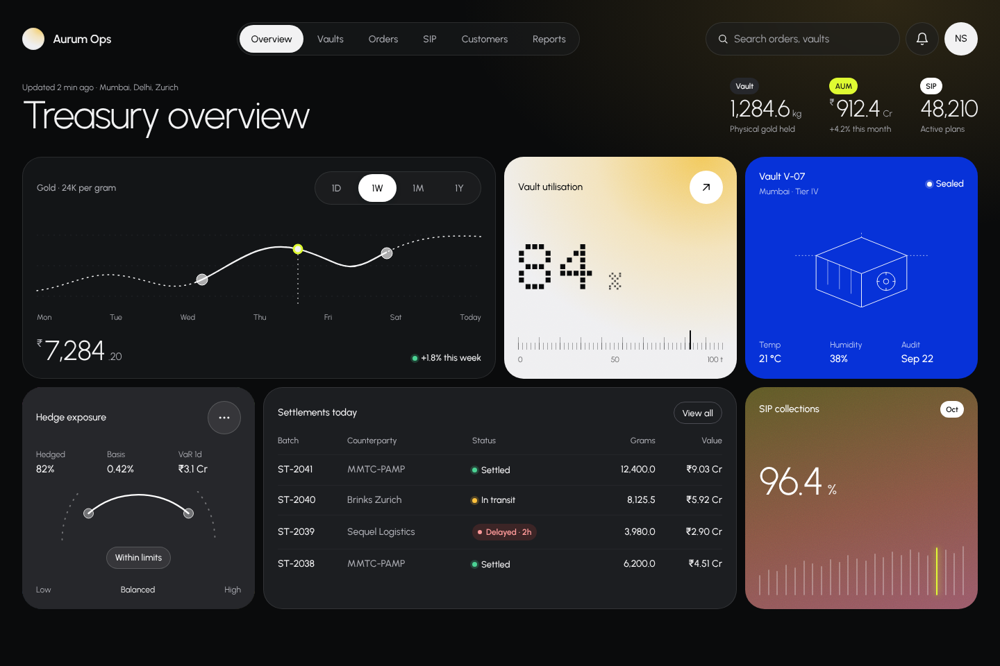
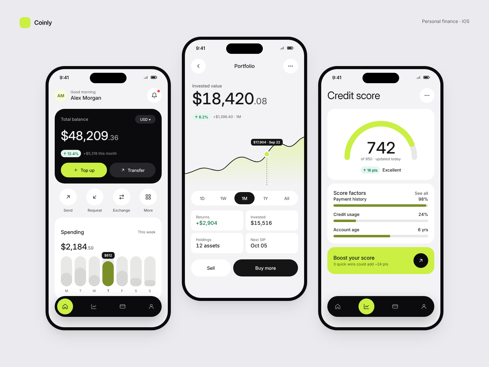
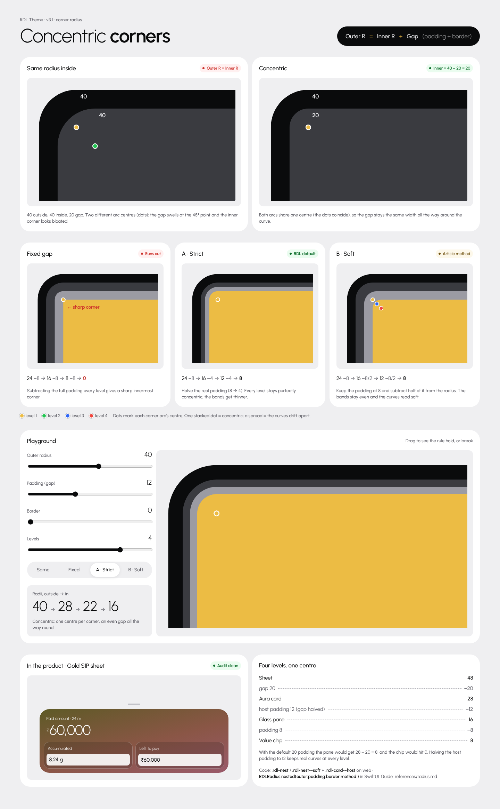

# RDL Theme · v4

A Claude Code skill and design system for building apps in the visual language of
[RonDesignLab](https://dribbble.com/RonDesignLab). It's based on **three passes over the 219-frame
RDL board** (style, structure, themes) plus pixel calibration, and structured after Apple HIG,
Material 3, Radix Colors and Primer. The style is:
- frosted glass over photos, 3D renders and soft gradient auras
- huge light-weight numerals with small muted units, plus dot-matrix figures
- orbs, pills and circle–pill–circle action rows
- tick rulers and hairline instruments
- status dots
- line-art and blueprint illustration

The original flat fintech look (v1) ships as an option.

**New in v4: three themes.** Light, Dark and **Brand**: you pick a primary and a secondary colour;
the primary fills the Brand canvas (and brand panels in Light/Dark), the secondary is the highlight
everywhere. One engine derives ~70 semantic roles (HIG/M3-style: backgrounds, foregrounds, fills,
borders, actions, accent, status, materials, data, elevation, states) and proves every contrast pair;
the build fails if one misses. It runs at build time, at runtime in the browser (`RDL.setTheme`) and
on iOS (`RDLTheme.apply`), with identical results. v3 names keep working as aliases.







**From v3:** a measured layout system (spacing ladder, screen skeleton, 12-column bento,
control-height ladder, nested radius), exact component anatomy, a usage rulebook (hierarchy,
color budget, app-wide consistency) and **`audit_ui.mjs`**. The audit renders a page and fails
on off-scale type, off-ladder spacing, wrong radii, mixed control heights, crowded pinned zones
and text contrast measured on the real pixels. Both reference templates pass with 0 errors.

Ask Claude something like *"build the SIP screen of my gold app in RDL theme, SwiftUI, gold
accent"*. It follows the rules, tokens, components and QA checklist in this repo.



| Glass dashboard · light | Glass dashboard · dark |
|---|---|
|  |  |

| Glass · volt accent | Flat (v1) option |
|---|---|
|  |  |

## Install

**As a Claude Code plugin**
```
/plugin marketplace add nkchaudhary-1/RDL-Theme
/plugin install rdl-theme@rdl-theme
```

**As a standalone skill**
```bash
git clone https://github.com/nkchaudhary-1/RDL-Theme
cp -r RDL-Theme/skills/rdl-theme ~/.claude/skills/            # all projects
# or: cp -r RDL-Theme/skills/rdl-theme <project>/.claude/skills/  # one project
```

**As a single file (RDL)**
[`RDL/SKILL.md`](RDL/SKILL.md) is the whole skill in one file: the full guide (§1–§12) plus every
source file as appendices. Each appendix heading names the path to save it at, so you can rebuild
the full skill from it.
```bash
cp -r RDL-Theme/RDL ~/.claude/skills/        # or upload RDL/SKILL.md as a custom skill on claude.ai
```
It's large (~330 KB) because it embeds all code. Use the folder skill above when you want the lean
version. Regenerate it after any change: `node scripts/build-rdl-single.mjs`.

## Use it in code

**Web**
```html
<link href="https://fonts.googleapis.com/css2?family=Urbanist:wght@300;400;500;600;700&family=Doto:wght@700&display=swap" rel="stylesheet">
<link rel="stylesheet" href="tokens.css">
<link rel="stylesheet" href="rdl-components.css">
<html data-theme="light" data-accent="gold">       <!-- light · dark · brand -->
<html data-theme="brand" data-brand="gold">        <!-- brand preset pair -->
<script src="rdl-theme.js"></script>
<script>RDL.setTheme("brand", { primary: "#0732D8", secondary: "#F2D33C" })</script>  <!-- any pair -->
```
**Tailwind:** import `tokens.css`, then `presets: [require('./tailwind.preset.js')]`. Utilities follow
the theme (`bg-bg-surface`, `text-fg-secondary`, `bg-action-primary`).

**SwiftUI (iOS 17+):** add `RDLTokens.swift`, `RDLThemeEngine.swift`, `RDLComponents.swift`,
`RDLGlassComponents.swift` and `RDLLayout.swift`, then:
```swift
RDLTheme.apply(.brand(primary: "#0732D8", secondary: "#F2D33C"))   // or .light, .dark, .system
ContentView().rdlThemedRoot().rdlSurfaceStyle(.glass)
```

| Switch | Values |
|---|---|
| Theme | `light` · `dark` · `brand` · (omit = follow the system light/dark) |
| Brand pair | `cobalt` (default) · `mustard` · `gold` · `olive` · `forest` · `lavender` · `plum` · `vermilion` · `dusk`, or any two colours at runtime |
| Secondary (light/dark) | `volt` (default) · `gold` · `signal` · `electric` · `ember` · `orchid` · `rose` · `lime` · `violet` · `orange` · `ocean`, or any colour |
| Style | `glass` (default) · `flat` (v1) |

Try any pair live: [`assets/templates/theme-studio.html`](skills/rdl-theme/assets/templates/theme-studio.html).

## What's inside

```
skills/rdl-theme/
├── SKILL.md                     RDL DNA, workflow, quick reference, anti-patterns
├── references/
│   ├── themes.md                Light, Dark, Brand: the two colours, the brand algorithm, contrast, states, elevation
│   ├── tokens.md                Every role with its value per theme, scales, component tokens (generated)
│   ├── layout.md                Spacing ladder, screen skeleton, grids, alignment, control heights, radius
│   ├── anatomy.md               Exact specs for every component and layout primitive
│   ├── radius.md                Corner radius: scale, concentric nesting, strict vs soft, code, audit
│   ├── guidelines.md            Rulebook: hierarchy, type, color budget, consistency, minimalism
│   ├── design-study.md          220-frame analysis: frequencies, 20 structural rules, v1→v3
│   ├── foundations.md           Modes, color, accents, auras, glass, type and numerals, radius, imagery, motion
│   ├── components.md            Glass + base components, SVG patterns, domain compositions
│   ├── screen-patterns.md       Glass G1–G8 / W5–W7, flat M1–M7 / W1–W4
│   ├── domain-playbooks.md      Wealth/gold/SIP/lease, banking, health, energy, logistics, industrial…
│   ├── presentation.md          Hands, depth-of-field close-ups, angled devices, three-phone perspective
│   └── qa-checklist.md
├── assets/
│   ├── tokens/                  tokens.json (source) → tokens.css, tailwind.preset.js, contrast-report.md; rdl-theme.js (engine)
│   ├── ios/                     RDLTokens.swift (generated), RDLThemeEngine.swift, RDLComponents.swift, RDLGlassComponents.swift, RDLLayout.swift
│   └── templates/               rdl-components.css, themes.html, theme-studio.html, glass + flat references, radius-demo.html
└── scripts/
    ├── build_tokens.mjs         tokens.json → CSS / Tailwind / Swift / tokens.md, contrast-checked
    ├── audit_ui.mjs             Layout, consistency and contrast audit for any HTML build
    └── extract_palette.py       Pixel-calibrate tokens against exported shots
research/
├── moodboard-notes.md           Pass 1: per-frame style notes (220 frames)
├── deep-scan.md                 Pass 2: per-frame structure, radius, type and composition notes
├── calibration.md               Pixel-sampled colors and measured layout values
├── theme-scan.md                Pass 3: every frame classified light / dark / brand, measured theme colours
├── standards.md                 HIG, Material 3, Radix and Primer values used for v4 structure
└── frames.tsv                   Frame index used for calibration
```

Single-file style guide: [`DESIGN-STYLE.md`](DESIGN-STYLE.md).

Corner-radius guide and interactive demo (concentric nesting, strict vs soft, playground):
[`references/radius.md`](skills/rdl-theme/references/radius.md) ·
[`assets/templates/radius-demo.html`](skills/rdl-theme/assets/templates/radius-demo.html)



Changing tokens:
```bash
node skills/rdl-theme/scripts/build_tokens.mjs
node scripts/render-previews.mjs     # refresh docs/ screenshots (needs Playwright)
```

Auditing a page (0 errors before shipping):
```bash
node skills/rdl-theme/scripts/audit_ui.mjs my-screen.html                 # phone shot, 44pt targets
node skills/rdl-theme/scripts/audit_ui.mjs dashboard.html --w 1440 --h 960 # desktop, pointer targets
```
Put `data-audit-scope` on the product UI root and `data-audit-ignore` on presentation chrome.

## Status

- **Evidence:** every frame on the board was viewed twice (style, then structure) and annotated.
  Colors are pixel-sampled from the board renders (`research/calibration.md`). Layout values are
  measured from mostly angled or depth-of-field shots, so treat them as ±2pt, snapped to the 4pt
  grid. To re-run calibration on your own exports, put them in `research/shots/` (git-ignored)
  and run `python3 skills/rdl-theme/scripts/extract_palette.py research/shots`.
- **Contrast** is proven for every role pair in every theme and preset
  (`assets/tokens/contrast-report.md`); the brand engine was fuzzed with 4,000 random colour pairs
  with no failures.
- **SwiftUI** was written without a compiler in the build environment. Build it once in Xcode
  and report any fixes. The audit covers HTML builds; apply the QA checklist by hand for SwiftUI.
- **Flat (v1) templates** keep their original inline values and aren't audit-clean; the glass
  templates (`themes.html`, `mobile-app.html`, `web-dashboard.html`) are the reference.

## Note

Independent style study, not affiliated with or endorsed by RonDesignLab. The repo contains no
RDL artwork; the reference screens are original compositions with fictional data.
